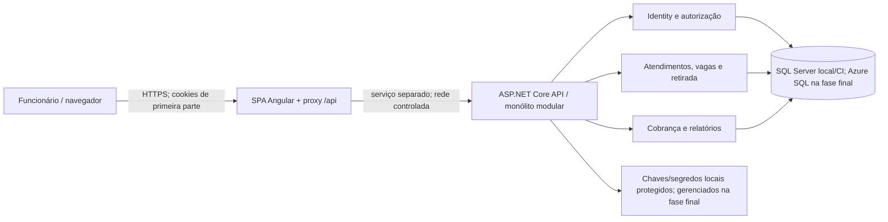
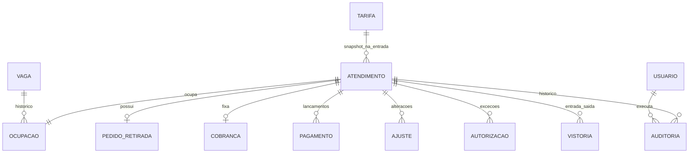
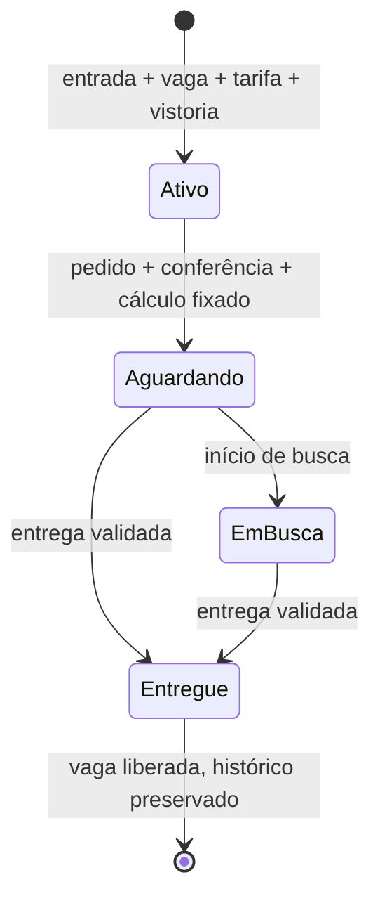

# TDD — Plataforma de Gestão de Estacionamento e Valet

**Status:** aprovado pelo solicitante em 10/11/2026 para orientar o desenvolvimento do MVP; validações pré-produção pendentes
**Data:** 10/11/2026 (versão original de 05/11/2026)
**Aprovação:** versão original aprovada pelo solicitante em 05/11/2026; revisão do roadmap e da estratégia de implantação aprovada pelo solicitante em 10/11/2026. A aprovação do design não dispensa os bloqueios de produção e as validações indicados neste documento e no PRD.
**Escopo:** MVP de uma unidade; documento de design técnico, não plano de test-driven development.  
**Decisor técnico:** solicitante (decisões registradas na entrevista desta conversa); responsáveis por operação, privacidade e negócio ainda não designados.  
**Fontes:** [`docs/prd/PRD.md`](../prd/PRD.md), aprovado para planejamento em 07/11/2026; `docs/entrevista.md`, entrevista fictícia; `README.md`, contexto e badges sugestivos, **não** aprovação de stack; decisão do solicitante em 10/11/2026 de adiar todo provisionamento e publicação Azure para a última fase.
**Divergências a resolver:** a versão original deste TDD referia-se à numeração de um PRD anterior. A tabela vigente está em `docs/prd/PRD.md`; este roadmap e o mapa ao final usam seus IDs. Pagamento normal integral é RF-07, sem habilitar parcial por causa da entrega excepcional. Ajustes/estornos, entrega direta, regras de divergência, retenção e operação com terceiros continuam pendentes; propostas do TDD não substituem aceite comercial ou operacional do PRD.

## 1. Resumo, objetivos e limites

Digitalizar entrada, ocupação de vaga, busca, retirada, cálculo, registro manual de pagamento, entrega e histórico auditável. Priorizar invariantes transacionais (RF-03/04/07/09; RNF-02), autorização no servidor (RF-11; RNF-01), proteção do documento e das vistorias (RNF-03) e rastreabilidade (RF-02/09). P1: relatórios sem comprometer as operações P0 (RF-10). Sem gateway, fotos, múltiplas unidades, emissão fiscal, app de cliente ou modo offline no MVP. A unidade, demanda, horário local, tarifa inicial, SLA e políticas de retenção/backup não são fatos conhecidos: são condições de implantação, não valores arbitrados aqui. **Até concluir P0 e P1, desenvolver e validar em ambiente local/CI; nenhum recurso Azure é provisionado ou recebe publicação antes da fase final.**

## 2. Registro central de decisões

**Origem:** “solicitante/inicial” = pedido desta conversa; “solicitante/entrevista” = respostas às perguntas técnicas; “PRD” = requisito aprovado. Versões não explicitamente confirmadas serão fixadas e verificadas antes da implementação, sem inferir aprovação dos badges do README.

| ID | Tema | Decisão e estado | Origem/decisor | Justificativa, alternativas e consequências |
| --- | --- | --- | --- | --- |
| DT-01 | Frontend | **Confirmada:** Angular **22**, TypeScript, componentes standalone, Zoneless, Signals e Signal Forms. | Solicitante/inicial e entrevista | Estado reativo sem ZoneJS; alternativa Reactive Forms. Verificar compatibilidade de cada dependência e testes com Angular 22; manter validação autoritativa no servidor. Zoneless é o padrão documentado desde Angular 21. |
| DT-02 | UI | **Confirmada:** Tailwind CSS e Lucide Icons; componentes e controles Angular nativos, sem Angular Material no MVP. | Solicitante/entrevista | Flexibilidade e menos dependências de componentes; exige cuidado explícito com teclado, foco, contraste e rótulos. Versões compatíveis a fixar. |
| DT-03 | Backend | **Confirmada:** C#/.NET **10**, ASP.NET Core Web API com controllers, solução `.slnx`, Clean Architecture e DDD pragmático. | Solicitante/inicial e entrevista | Casos de uso independentes de HTTP e EF; alternativa Minimal APIs. Evitar agregados artificiais e abstrações genéricas desnecessárias. |
| DT-04 | Topologia | **Confirmada:** monólito modular, uma API de negócio, módulos internos de Atendimento/Retirada, Vagas, Cobrança, Identidade e Relatórios. | Solicitante/entrevista | Uma transação relacional para invariantes; alternativa microsserviços exigiria coordenação distribuída. Módulos não significam deploys separados. |
| DT-05 | Persistência | **Confirmada:** SQL Server com Entity Framework Core, migrações versionadas; Azure SQL continua alvo **somente na fase final**. | Solicitante/entrevista e revisão de 10/11/2026 | Integridade e consultas transacionais; alternativa PostgreSQL. Usar SQL Server real em desenvolvimento/testes locais/CI; escolher versões compatíveis com .NET 10 antes de implementar; não provisionar Azure SQL antes da última fase. |
| DT-06 | Autenticação | **Confirmada:** ASP.NET Core Identity com sessão em cookie seguro, HttpOnly, de primeira parte; papéis fixos manobrista, caixa, administrador. | Solicitante/entrevista; RF-11 | Alternativas OIDC/tokens. Criação administrativa de usuários, sem autorregistro; autorização por operação e projeção de leitura. Não confundir usuários de teste locais com provisionamento de recursos Azure. |
| DT-07 | Publicação web | **Confirmada como topologia-alvo:** SPA e API em **sites distintos** na Azure **apenas na última fase**; navegador usa exclusivamente `/api` na origem da SPA por proxy reverso/BFF. **Antes disso:** serviços separados com proxy equivalente em ambiente local/CI, sem publicação Azure. | Solicitante/entrevista e revisão de 10/11/2026 | Alternativas: mesma origem de hospedagem ou OIDC/tokens. Testes locais exercitam cookies de primeira parte, mas não validam ingress, cadeia de proxies nem segurança dos sites Azure; esses são gates da fase final. Não adicionar outro backend de domínio. |
| DT-08 | Atualização de operação | **Confirmada:** polling curto e configurável da fila/vagas, refetch após comando e ao recuperar foco; sem SignalR no MVP. | Solicitante/entrevista | Menos infraestrutura; atraso controlado, mas tela nunca é fonte de verdade para disponibilidade. Medir intervalo/carga no piloto (RNF-05). |
| DT-09 | Proteção sensível | **Confirmada como desenho inicial:** criptografia de campo para número de documento e textos de vistoria, menor privilégio e trilha de acessos relevantes. **Pendente para produção:** política de acesso, chaves, retenção e descarte aprovada por negócio/privacidade. | Solicitante/entrevista; RNF-03 | Complementa TLS e criptografia do banco; busca por placa/ID não requer decifrar documento. Evitar indexar texto confidencial; mascarar campos na UI e nos logs. |
| DT-10 | Testes | **Confirmada:** MSTest (.NET) para unidade/integração, SQL Server real nos testes de integração; Vitest (frontend), Playwright (E2E). | Solicitante/inicial e entrevista | SQLite/InMemory não reproduzem restrições SQL Server; E2E cobre fronteiras de perfil/sessão. Fixar versões e runner compatíveis ao configurar o projeto. |
| DT-11 | Entrega | **Aprovada pelo solicitante em 10/11/2026 para orientar o desenvolvimento:** GitHub Actions para CI local/CI nas fases 1–6; **somente a fase final** provisiona Azure, faz homologação hospedada, migração controlada e eventual publicação em produção, sem fornecedor de pagamentos. A publicação continua condicionada aos gates de produção. | Solicitante/entrevista e revisão de 10/11/2026; PRD | Alternativa: homologação/publicação Azure na fase 1 ou liberação P0 antes de P1; descartada por instrução do solicitante. Escolha de SKU, rede, custos e serviços depende de validação operacional e de segurança na fase final; não interpretar P0 funcional como liberação. |
| DT-12 | Consistência | **Definida neste TDD para cumprir PRD:** comandos atômicos com constraints SQL, `rowversion` quando há mutação concorrente, idempotência em comandos críticos e auditoria na mesma transação. | Derivada de RF-03/04/07/09; RNF-02 | Alternativa bloqueios distribuídos é excessiva no monólito; conflitos resultam em resposta explícita e recarga, nunca sobreposição silenciosa. |
| DT-13 | Relatórios | **Definida neste TDD:** consultas somente leitura sobre dados operacionais e eventos imutáveis, sem banco analítico no MVP. | Derivada de RF-10 e DT-04 | Simples para uma unidade; agregar/materializar apenas se medições do piloto demonstrarem necessidade. |
| DT-14 | Tempo e valores | **Definida neste TDD:** instante UTC persistido, conversão para fuso configurado da unidade em exibição/agrupamento; dinheiro em decimal com precisão explícita no SQL; relógio do servidor é fonte de eventos. | Derivada de RF-06/10/12 | Evita depender do relógio do navegador e de horário de verão para períodos de 24 h. Fuso e moeda/regra de arredondamento final são dados de implantação a confirmar. |

## 3. Arquitetura e organização



**Fronteira de confiança (DT-06/07):** antes da fase final, SPA/proxy e API executam como serviços separados em ambiente local/CI; somente a origem da SPA deve ficar acessível ao navegador. Testes com navegador real exercitam `/api`, login, antiforgery, logout, cookies host-only, HTTPS e negação de bypass na rede de teste. Na fase final, os dois sites Azure devem preservar essa origem de acesso, com ingress restrito e autenticação entre edge/API; validar de novo `Set-Cookie`/`Cookie`, cabeçalhos de CSRF, host, caminho e cadeia de proxies confiáveis **na Azure antes de permitir publicação produtiva**. A validação local não comprova o isolamento nem o comportamento do ambiente hospedado. Nunca aceitar cabeçalhos de identidade do cliente como autenticação; o edge encaminha, não executa regras de negócio.

Estrutura proposta (DT-01–05, DT-10):

```text
frontend/                         Angular 22
  src/app/core/                   sessão, transporte HTTP, erros, guards
  src/app/features/               check-in, vagas, retirada, cobrança, admin, relatórios
  src/app/shared/                 componentes acessíveis, formatação, estados
backend/
  Estacionamento.slnx
  src/Estacionamento.Api/         controllers, DTOs, políticas, middleware, composição
  src/Estacionamento.Application/ casos de uso, portas, projeções, autorizações de ação
  src/Estacionamento.Domain/      entidades, valores, regras e eventos de domínio
  src/Estacionamento.Infrastructure/ EF Core, Identity, criptografia, auditoria, consultas
  tests/Estacionamento.UnitTests/
  tests/Estacionamento.IntegrationTests/
tests/e2e/                        Playwright
```

Dependências: Api → Application e Infrastructure (composição); Infrastructure → Application/Domain; Application → Domain; Domain → nenhuma camada externa. Separar funcionalidades internamente por módulo/caso de uso, não por controllers inchados nem repositório genérico. DTOs nunca expõem entidades EF ou número de documento por padrão. Frontend por funcionalidade, com Signals para estado local/derivado e Signal Forms para entrada/validação; chamadas HTTP na camada de serviços; rotas/guards apenas complementam a autorização da API. Polling pausa em aba inativa, usa cancelamento e evita requisições sobrepostas; mutation sempre força releitura (DT-08).

## 4. Modelo de dados, estados e concorrência



**Entidades e invariantes (DT-05/12/14):** `Atendimento` tem ID interno e identificador público único, placa normalizada (não única historicamente), modelo, titular, documento criptografado, tarifa capturada na entrada, operador, horários e estado; `Vaga` tem código único e status derivável da ocupação aberta; `Ocupacao` guarda início/fim e responsável. `Vistoria` textual, tipo entrada/saída e autor; `PedidoRetirada` tem verificação presencial (resultado, operador, horário), hora fixadora de cobrança e estados; `Cobranca` preserva base original (tempo em segundos, diárias, tarifa e total); `Ajuste`/`Pagamento`/`Autorizacao` são lançamentos não apagáveis; `Auditoria` referencia ator, ação, atendimento, horário e metadados mínimos. `Tarifa` é versionada; editar tarifa cria nova vigência e não altera snapshots. Usuários Identity e perfis são separados dos registros históricos; desativar funcionário não apaga autoria.

Restrições SQL: identificador único; código de vaga único; índice único **filtrado** em `Ocupacao(vaga_id)` onde `fim IS NULL`; índice único de pedido por atendimento (um pedido no ciclo do MVP); referências obrigatórias; índices em placa normalizada+horário, identificador, estado/horário de pedido e eventos de ocupação/horários. Índice filtrado e/ou constraint impedem dupla ocupação mesmo quando duas leituras veem a vaga livre; erro vira conflito HTTP, não erro genérico. Marcar entidades mutáveis de atendimento/vaga com `rowversion`; entregar somente se a ocupação aberta referenciar o atendimento correto. Eventos financeiros e trilha não sofrem `UPDATE`/`DELETE` por operações normais. Criptografia de campo deve preservar acesso ao documento para conferência autorizada; não registrar documento puro em auditoria, telemetria ou índices. Chaves versionadas permitem rotação sem perda de leitura do histórico; procedimentos de recuperação dessas chaves acompanham backup.



Fila: `aguardando → em busca → entregue`; a passagem direta de aguardando para entregue é **proposta técnica**, sujeita à validação operacional prevista no PRD; sempre exige pedido prévio. Conferência divergente é registrada no pedido; o procedimento de resolução exige decisão de operação/gestão antes de habilitar entrega nesses casos. No instante transacional do pedido, `diárias = max(1, teto((pedido_utc - entrada_utc)/24h))`; exatas 24 h = 1, 24 h + 1 segundo = 2. Total inicial = diárias × tarifa snapshot; tempo e valor ficam imutáveis. Ajustes posteriores como lançamentos justificados e estornos compensatórios são desenho **condicionado à aprovação comercial**, preservando base e histórico; não são fluxo aprovado pelo PRD. Pagamento normal deve ser integral do saldo exigível; tentativa parcial é recusada. Entrega com saldo requer política aprovada e autorização segregada específica, nunca pagamento parcial implícito. Cobrado, pago e saldo são calculados com lançamentos, inclusive depois de atendimento encerrado, sem editar os anteriores. Detalhes comerciais de desconto/estorno e efeitos de eventual pagamento posterior permanecem pendentes antes da implementação financeira final.

**Transações:** check-in insere atendimento, snapshot de tarifa, vistoria, ocupação e auditoria atomicamente; pedido cria verificação, cobrança e evento; pagamento cria lançamento/quitação; entrega valida autorização vigente, vistoria, cobrança, ocupação, encerra pedido/atendimento/ocupação e grava auditoria na **mesma transação**. Em conflito de `rowversion` ou unicidade, rollback e `409` com estado recarregável. Para erro transitório de SQL Server (incluindo Azure SQL na fase final), retry só da unidade transacional inteira e com idempotência; não repetir cegamente operações de escrita após timeout de resultado desconhecido. Migrações EF Core devem ser testadas em SQL Server real desde as fases locais e revisadas antes de liberar tráfego na fase final; migrations destrutivas exigem estratégia compatível/backup e janela de mudança.

## 5. Interfaces, autorização e sequências

API HTTP JSON versionada em `/api/v1`, contrato OpenAPI gerado dos endpoints e exemplos de erros versionados. Endpoints **propostos para revisão de contrato**, sem impor nomes de DTOs: login/logout/estado da sessão e antiforgery; usuários/perfis; vagas; tarifas; atendimentos (criar, buscar, detalhar); pedidos de retirada (criar, listar, iniciar busca); cobrança, ajustes, pagamentos, autorizações; entrega; auditoria; relatórios. Busca por placa retorna lista paginada e distingue visitas por identificador/entrada; lista de vagas/fila é paginável/filtrável. Servidor valida formato, tamanho, transições, direitos e invariantes; hora e valores enviados pelo cliente não prevalecem sobre cálculo do servidor. Não expor dados financeiros nas projeções do manobrista nem número de documento em listagens; caixa/admin recebem apenas dados necessários à conferência presencial, com leitura auditável. Autenticar e autorizar cada operação no servidor; matriz base:

| Operação | Manobrista | Caixa | Admin |
| --- | --- | --- | --- |
| Consultar veículo/vaga/fila; vistoria e início de busca | Sim, sem finanças/documento completo | Sim | Sim |
| Check-in, pedido, cobrança e pagamento, entrega normal | Não | Sim | Sim |
| Tarifa, acessos, ajustes, exceções, relatórios financeiros | Não | Não | Sim |
| Consultar histórico financeiro/documento para conferência | Não | Somente se necessário à operação | Sim, com trilha |

**Sessão/CSRF (DT-06/07):** Identity autentica funcionários previamente provisionados. Cookie de sessão HttpOnly, Secure, SameSite adequado à navegação de primeira parte, duração/expiração e bloqueio de login configuráveis antes da produção. Endpoint de emissão de token antiforgery pela origem `/api`; token de requisição apresentado pela SPA em cabeçalho para **todas** as operações mutáveis (inclusive login/logout); servidor valida token e origem esperada. Não confiar somente em SameSite ou em guard Angular. Proxy não deve cachear respostas privadas nem encaminhar cookies a destinos arbitrários; controles de rate limit em login, política de senhas, rotação de segredos e proteção contra enumeração. APIs externas diretas não recebem sessão do browser; restringir ingress da API ao proxy/rede autorizada. Testar fluxo real de `Set-Cookie`, expiração, CSRF e logout em navegador.

**Erros e idempotência:** `400` dados inválidos, `401` sem sessão, `403` sem permissão, `404` recurso inexistente ou não revelável, `409` conflito de estado/ocupação/pedido repetido, `422` regra de domínio não satisfeita (p.ex. entrega sem vistoria); `5xx` falha inesperada com ID de correlação, nunca stack trace/dados sensíveis. Comandos de check-in, pedido, pagamento e entrega levam chave de idempotência gerada por ação do cliente; persistir chave+ator+operação+hash canônico do pedido+resultado em transação, com restrição única. Mesma chave/mesmo conteúdo retorna resultado original; mesma chave/conteúdo diferente é conflito. Não liberar vaga duas vezes nem lançar pagamento duas vezes se navegador repetir/timeout. TTL de chaves a definir conforme janela operacional e retenção; registros de negócio não são apagados pelo TTL. Sem token ou chave, um retry automático de escrita não é seguro. Leituras GET podem ser repetidas; políticas de cache evitam dados pessoais persistidos em proxies.

```mermaid
sequenceDiagram
  actor Caixa
  participant UI as SPA / proxy
  participant API as API / casos de uso
  participant SQL as SQL Server
  Caixa->>UI: solicita retirada e informa conferência presencial
  UI->>API: POST pedido (cookie, CSRF, chave idempotente)
  API->>SQL: transação: verificar ativo/sem pedido, fixar hora/diárias/total, auditar
  SQL-->>API: commit ou conflito
  API-->>UI: identificador, estado, cobrança ou erro
  UI->>API: GET fila (polling)
  Caixa->>UI: registra pagamento integral e entrega
  UI->>API: comandos com novas chaves e CSRF
  API->>SQL: validar saldo/conferência ou autorização; gravar vistoria/entrega/liberação/auditoria
  SQL-->>API: commit único ou rollback
  API-->>UI: estado final ou conflito com recarga
```

Falha de rede antes de saber se houve commit: repetir **a mesma chave** e consultar estado, nunca iniciar novo pagamento com outra chave sem verificar o lançamento anterior. Divergência documental exige exceção registrada e autorizada pelo admin; saldo pendente exige autorização independente, vinculada ao atendimento, tipo de exceção, justificativa, autor e horário. Resposta de autorização não substitui pagamento ou conferência; vale apenas para a entrega correspondente. Sem integrações externas de pagamento, tickets ou fiscal no MVP (PRD §10).

## 6. Segurança, operação e implantação

**Ameaças e controles (DT-06/07/09/12):** acesso indevido de manobrista a finanças/documento; CSRF e roubo de sessão; tentativa de entrega fraudulenta; dupla ocupação/cobrança; logs vazando PII; backup sem chaves. Implementar autorização por ação e por campo no servidor, conferência presencial com número/documento de foto, justificativa para exceção, TLS, criptografia de campos sensíveis e auditoria append-only protegida contra edição por perfis comuns. Nas fases locais, usar segredos de teste fora do repositório e não coletar dados reais de clientes; armazenamento gerenciado de segredos/chaves, criptografia do banco hospedado, segregação de contas de serviço, rotação e proteção de ingress são gates **da fase final**. Política de leitura do número completo e retenção/descarte depende de responsável de privacidade; **não lançar produção com essa política indefinida**. Vistorias são somente texto (PRD), sem anexos.

**Observabilidade (RNF-05/06):** logs estruturados com correlation ID, ator interno pseudonimizado quando possível, ação, resultado, latência e conflito; métricas de logins falhos, erros HTTP, fila/polling, indisponibilidade SQL, colisões de vaga, pagamentos e exceções; trilha de negócio na transação, separada de logs técnicos. Não incluir documento, vistoria, cookie nem payload financeiro sensível em logs/traces. Alertas e retenção operacional a aprovar com administrador. UTC para eventos; fuso da unidade para períodos de relatório. Receita por período = pagamentos registrados no período; cobrado = cobranças/ajustes com recorte definido em relatório; saldos pendentes incluem entregas excepcionais apenas se autorizadas por política aprovada. Documentar definição de cada métrica para evitar somas de bases temporais diferentes; validar com financeiro no piloto da fase 7.

**Entrega local/CI e Azure somente ao final (DT-11):** nas fases 1–6, executar SPA/proxy, API e SQL Server em desenvolvimento e CI, com dados sintéticos, rede de teste controlada, segredos fora do repositório e testes Vitest/MSTest/SQL Server real/Playwright. GitHub Actions executa restore/build, formatação/análise, testes e varredura de dependências; **não cria recursos nem publica na Azure** antes da última fase. Desenvolvimento e testes locais não são homologação hospedada nem uso real. **Na fase 7**, escolher produtos/SKUs e topologia de rede com operação/segurança, provisionar ambientes Azure isolados de homologação e produção, configurar edge HTTPS no site da SPA com proxy `/api`, API separada com ingress restrito, Azure SQL e serviço gerenciado de segredos/chaves e key ring durável. Somente nessa fase executar homologação real, migrations revisadas/aprovadas, smoke tests, teste de carga/piloto com dados permitidos e, após aprovações, deploy produtivo controlado. Rollback de aplicativo para versão compatível com esquema anterior; migrações preferencialmente aditivas/expand-contract. Restore do SQL **e** das chaves de campo/Data Protection deve ser exercitado antes de produção; RPO/RTO, retenção, disponibilidade e contingência para rede indisponível são bloqueios a validar com operação. Sem prometer modo offline ou ausência absoluta de perda em falhas de infraestrutura; restore deve cumprir metas aprovadas.

## 7. Qualidade e verificação

| Nível | Verificações mínimas e rastreabilidade |
| --- | --- |
| Unidade — MSTest | Máquina de estados, tarifação em 0/24/24h+1s/48h, snapshot de tarifa, saldo e autorização, permissões de caso de uso (RF-03–09/11/12). |
| Integração — MSTest + SQL Server real | Migrações, índices filtrados, EF `rowversion`, transações/auditoria, criptografia e múltiplos escritores concorrentes sobre a mesma vaga, pedido, pagamento e entrega; retry/idempotência após timeout, em SQL Server local/CI nas fases 1–6 (RF-01–09/11/12; RNF-01–03). |
| Contrato/API | OpenAPI e testes HTTP de projeções por perfil, erros, paginação, sessão, CSRF, autenticação e negação inclusive acesso direto à API no ambiente local/CI; repetir o teste de ingress em Azure na fase 7 (RF-11; RNF-01/03). |
| UI — Vitest | Signal Forms, validações e estados textuais, polling sem requisição sobreposta, expiração de sessão e feedback de conflitos; testes com configuração Zoneless coerente (RNF-04/05). |
| E2E — Playwright | Jornadas locais/CI de check-in até entrega, ticket extraviado, documentos divergentes, exceções condicionadas à aprovação, tarifa alterada, relatórios restritos, cookies/CSRF via proxy, repetição de comando e teclado (RF-01–12; RNF-01/04); repetir fluxos críticos na homologação Azure somente na fase 7. |
| Não funcionais | Auditoria de vazamento de PII em logs/respostas, revisão de acesso e acessibilidade com equipe antes de liberação; carga em ambiente hospedado, restore SQL/chaves, rotação e rollback na fase 7 (RNF-02–06). |

Critérios técnicos de gate **funcional** do P0: nenhuma dupla ocupação ou liberação/pagamento duplicado em testes concorrentes; nenhum fluxo não autorizado alcança dados financeiros/documentais; snapshot e valores originais preservados. Isso não é autorização de produção. Para o aceite **funcional** P1, relatórios devem reconciliar lançamentos, inclusive saldo após entrega. Resultado de restore, validação do ingress/proxy Azure e métricas de carga confrontadas com metas **a aprovar** são gates separados da fase 7 antes de produção. Critério normativo/nível de acessibilidade ainda depende de produto/design; navegação por teclado e rótulos textuais são obrigatórios desde o MVP.

## 8. Roadmap de implementação (sem implementação neste documento)

Fases ordenadas por dependência, **sem prazos ou estimativas assumidos**. Nas fases 1–6, só há desenvolvimento e verificação **local/CI**, sem provisionamento, homologação hospedada ou publicação Azure. As fases 1–4 compõem o P0 funcional; a fase 5 verifica sua prontidão técnica e registra gates ainda pendentes; a fase 6 conclui relatórios P1 após P0 funcional, sem reabrir seu aceite. **Somente a fase 7**, depois de P0 e P1 funcionais, provisiona Azure, homologa em hospedagem real e, se os bloqueios forem resolvidos e houver aprovações, publica em produção. Adiar a publicação de P0 até após P1 não altera a prioridade funcional P0 nem transforma P1 em critério de aceite de P0.

| Fase | Escopo e entregáveis | Dependência / critério de saída |
| --- | --- | --- |
| **1 — Fundação local e CI** | Registrar pendências de fuso, moeda, volumes, política de dados e responsáveis. Criar solução `.slnx`, Angular, CI, SQL Server local/CI, segredos de teste fora do Git e proxy `/api` entre serviços separados; estabelecer sessão, autorização básica e antiforgery. | **Início do projeto.** Testes automatizados e navegador real em ambiente local/CI demonstram login/logout, cookie de primeira parte, CSRF e bypass negado na rede de teste; fixar e verificar versões das dependências (DT-01/05–07/10/11). Nenhuma validação Azure é presumida; pendências de produção ficam registradas. |
| **2 — Preparação e entrada (P0)** | Identity e perfis, cadastro de vagas e tarifa versionada, migrações/constraints, check-in com snapshot, vistoria de entrada e busca por placa/ID; auditoria e idempotência do check-in. | **Após fase 1.** Testes com SQL Server real local/CI comprovam autorização por perfil, entrada atômica e impossibilidade de dupla ocupação concorrente; jornada de entrada demonstrável localmente (RF-01–03/11/12; RNF-01/02). |
| **3 — Retirada e caixa (P0)** | Pedido e conferência presencial, fila/polling, cobrança fixada em diárias e pagamento integral; ajustes/estornos e exceções **apenas após aprovação das respectivas políticas**. | **Após fase 2.** Negócio/financeiro define regras ainda pendentes **antes de implementar/habilitar** ajustes, estornos e entrega com saldo; sem aprovação, manter fluxo excepcional desabilitado. Testes locais/CI cobrem limites de 24 h, snapshot, perfis, pedido/pagamento repetidos e timeout com mesma chave (RF-05–08/11; RNF-01/02). |
| **4 — Entrega e operação completa (P0)** | Vistoria de saída, entrega e liberação transacionais, histórico, logs sem PII e jornadas E2E locais de perfis e conferência; caminhos excepcionais condicionados a políticas aprovadas. | **Após fase 3.** Entrega normal só conclui com conferência, vistoria e quitação; casos sem ticket exigem segregação e política de verificação aprovada. Testes locais/CI cobrem liberação/pagamento duplicado e preservação de auditoria (RF-02/04/07–09/11; RNF-01–03). **P0 funcional concluído local/CI; não liberado para operação real.** |
| **5 — Prontidão funcional do P0 (sem publicação)** | Revisar UX/acessibilidade e concorrência com cenários sintéticos; documentar métricas, necessidades de carga, backup/restore, contingência e pendências de aprovação para implantação futura. | **Após fase 4.** Relatório de testes e lista de gates com responsáveis (privacidade, operação e negócio) preservam pendências; nenhuma homologação Azure, piloto operacional, restore gerenciado ou autorização de produção é inferida (RNF-01–06). |
| **6 — Relatórios (P1; sem publicação)** | Implementar relatórios por período, volumes, receita e saldos pendentes, com acesso restrito e reconciliação em SQL Server local/CI. | **Após P0 funcional (fase 4), sem depender de publicação da fase 5.** Financeiro aprova recortes, datas de referência e fechamento antes do aceite P1; testes locais/CI reconciliam lançamentos e saldos pós-entrega (RF-10/11; RNF-02). Aceite P1 funcional não equivale a lançamento. |
| **7 — Provisionamento, homologação e publicação Azure (última fase)** | **Somente agora** escolher/provisionar sites distintos de SPA e API, edge `/api`, ingress protegido, Azure SQL, gestão de segredos/chaves, ambientes isolados de homologação/produção e CD controlado. Migrar esquema revisto, executar homologação real, piloto validado, carga/segurança, backup/restore de SQL **e** chaves, rollback e smoke tests; publicar em produção apenas com aprovação explícita. | **Após fases 1–6 e aprovação dos critérios funcionais aplicáveis de P0/P1.** Confirmar negócio/financeiro, operação e privacidade: tarifa/políticas, acesso/retenção, chaves, dispositivos, metas, RPO/RTO e contingência. Testar em navegador real cookies/CSRF, bypass da API, perfis, check-in→entrega e relatórios, além de restore/rollback. Se qualquer gate falhar, manter produção fechada; homologação Azure não implica liberação automática (DT-07/09/11; RNF-01–06). |

Migração inicial cria esquema vazio; não há importação automática no MVP. Até a fase 6, dados sintéticos em ambientes locais/CI, sem clientes reais nem publicação Azure. Na fase 7, homologar com dados permitidos e isolados, depois cadastrar vagas/usuários/tarifa reais em produção antes do primeiro check-in. Rollback de release conserva registros e usa versão anterior compatível; jamais apagar lançamentos confirmados para reverter deploy. Bloqueios de negócio e privacidade não podem ser contornados antecipando uma fase.

## 9. Riscos, alternativas e pendências

| Item | Situação/risco e encaminhamento |
| --- | --- |
| Edge em site diferente da API | **Topologia-alvo confirmada para a fase 7**, porém testes locais/CI não comprovam cookie/CSRF/proxy e ingress no Azure. Validar novamente em navegador real na homologação Azure antes de publicar; se inviável, rever topologia/autenticação com solicitante (DT-06/07). |
| Concorrência/latência | Polling e snapshots podem ficar defasados; constraints e transações são autoridade. Medir pico/rede, ajustar intervalo e índices com operação (DT-08/12). |
| Políticas comerciais | **Pendente:** regras exatas de desconto/estorno, acerto de saldo após entrega e definição de fechamento/recortes financeiros. Negócio/financeiro aprova exemplos e reconciliação antes do fluxo financeiro final; não criar estorno silencioso. |
| Privacidade | **Bloqueio de produção:** acesso autorizado ao documento, retenção/descarte, rotação/recuperação de chaves e retirada por terceiro. Administrador/privacidade valida procedimento (DT-09). |
| Disponibilidade e backup | **Bloqueio de produção:** RPO/RTO, política de backup/restore, plano de falha de rede e escala. Administrador/operação define e valida no piloto/ensaio hospedado da fase 7 (RNF-05). |
| Implantação | **Pendente:** tarifa inicial, mapa de vagas, usuários, fuso, moeda, volumes, domínios, serviço/SKU Azure e metas. Negócio/operação/infra confirmam antes da liberação na fase 7; nenhum recurso Azure será provisionado anteriormente. |
| Publicação adiada | **Decisão de sequência aprovada pelo solicitante em 10/11/2026:** P0 e P1 são verificados local/CI antes de qualquer Azure; não alegar homologação hospedada nem piloto operacional nas fases 1–6. Aprovações e testes em hospedagem real permanecem obrigatórios na fase 7. |
| Bibliotecas e versões | Angular 22 e .NET 10 confirmados; EF Core/provider, Tailwind, Lucide, Identity, Vitest, Playwright e MSTest têm **produtos confirmados, versões a fixar e verificar** no início da implementação. Signal Forms deve ser validado contra a documentação de Angular 22 no momento de fixar dependências. |

### Mapa de rastreabilidade

| Requisitos PRD | Componentes | Decisões | Verificação |
| --- | --- | --- | --- |
| RF-01/02/03/12, RNF-02/03 | Atendimento, Vagas, Tarifa, SQL, UI | DT-01/03/05/09/12/14 | Unitários, integração concorrente, vistorias e snapshot na entrada |
| RF-04/05/06 | Retirada, Cobrança, fila | DT-04/08/12/14 | Liberação só na entrega, limites de 24 h, pedido duplicado, transições, polling |
| RF-07/08/09 | Pagamento, Autorização, Entrega | DT-05/09/12/14 | Quitação integral, segregação sem ticket, transação, idempotência, exceções só após aprovação |
| RF-11, RNF-01/03 | Identity, proxy, API, projeções | DT-06/07/09 | Matriz HTTP de perfis, CSRF, dados mascarados, E2E local e novamente na fase 7 |
| RF-02/09, RNF-02/06 | Auditoria, logs | DT-09/12 | Autoria/timestamp em cada ação crítica; sem PII em logs |
| RF-10, RNF-05 | Relatórios, SQL | DT-08/13/14 | Reconciliação por período e saldos; carga em hospedagem na fase 7 |
| RNF-04/05/06 | UI, CI, infraestrutura | DT-01/02/10/11 | Teclado, acessibilidade e testes locais; restore e rollback Azure só na fase 7 |

**Referências técnicas consultadas:** [Angular Signal Forms](https://angular.dev/guide/forms/signals/overview), [Angular Zoneless](https://angular.dev/guide/zoneless), [ASP.NET Core antiforgery](https://learn.microsoft.com/aspnet/core/security/anti-request-forgery), [EF Core concurrency](https://learn.microsoft.com/ef/core/saving/concurrency), [EF Core connection resiliency](https://learn.microsoft.com/ef/core/miscellaneous/connection-resiliency) e [MSTest](https://github.com/microsoft/testfx). As versões de dependências não confirmadas aqui não são inferidas dessas referências.
